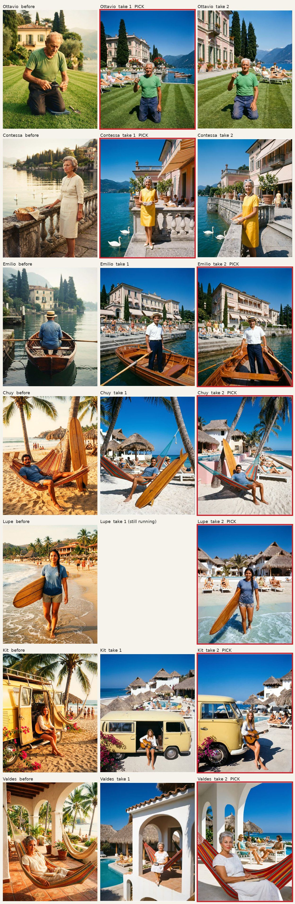

# Fix pictures that drift off the house look by naming the light

When a set drifts soft, misty or golden, the scene wording asked for that light. Ask for midday sun and a cloudless deep-blue sky in every portrait and the look comes back in one pass.

## What happened

On 26 November Alex put the three Villa Ceresa portraits (Ottavio, the Contessa, Emilio) outside the look book: "completely off". The Hotel Marisol portraits (Chuy, Lupe, Kit, Señora Valdés) had the same problem in a different colour. Set next to the 19 look-book pictures, every keeper has hard midday sun, a cobalt sky filling the top of the frame and strong primary colour. The rejects had:

- **Ceresa:** morning mist on the lake, a white sky and faded cream clothes. The prompts asked for a "still lake" and "cool of the morning".
- **Marisol:** an orange cast from edge to edge. `worlds.marisol.palette` in storefront-kit `look.json` says "in warm low golden light", and the scenes add "late-afternoon gold", "golden hour" and "early morning light". The model did what it was told.

The style paragraph alone can't hold the look if the scene names a different light, because the scene wording comes later and is more specific.

## What to do

1. Start with the house style paragraph (`house-style-prompt.md`), unchanged.
2. For a portrait, add one fixed sentence after it: one person, centred, square to the camera, looking into the lens; midday sun from behind the photographer, crisp hard shadows, a cloudless deep cobalt-blue sky filling the top of the frame, every colour saturated like a postcard. (The house paragraph says nobody looks at the camera, so the portrait sentence has to say it is the exception.)
3. Put one strong colour on the subject (a sunflower-yellow dress, a lawn-green shirt). Cream and white outfits on their own read as muted.
4. Take every time-of-day word out of the scene: golden hour, dusk, morning mist, low sun, late afternoon.
5. Check each take beside the look book sheet before anyone sees it.

## Prompt we used

House paragraph, then:

```
This frame is an environmental portrait, the one exception to the rule above: one person, full-length or three-quarter length, centred, standing or sitting square to the camera and looking straight into the lens with easy confidence, posed like a 1960s society portrait. Midday sun from high behind the photographer, crisp hard shadows, a cloudless deep cobalt-blue sky filling the top of the frame, every colour rich and saturated like a postcard. [Who, what they wear in one strong colour, where, two or three props.] Vertical 4:5, full-bleed. No text or lettering anywhere in the frame, no border.
```

All seven prompts are in `/mnt/project-files/odhc-remake-ceresa-marisol/prompts.json`.

## Settings and cost

Kling `text_to_image`, model `gemini-3-pro-image`, 4:5, 2K, `image_count` 2. 20 credits a picture, 280 for 14 (one Lupe take was still queued after five minutes). No references attached. Results were saved to Drive "ODHC shot results" as `RC-<hotel>-<name>-v1/v2.png` through Zapier Google Drive Upload File, because the cloud can't download from the Kling host. Thumbnails for checking came from Picsart `picsart_scene_contact_sheet(media=url)`.

## Lessons

| Slug | Lesson | Status |
| --- | --- | --- |
| light-in-scene-wins | Time-of-day words in the scene override the house paragraph. Midday sun and a cloudless cobalt sky, named in every prompt, held the look on 13 of 13 takes. | tested |
| portrait-exception | The house paragraph says "none of them looking at the camera". Portraits need a sentence that says they are the exception, or the model splits the difference. | tested |
| look-book-side-by-side | Judge a set beside the look book sheet rather than one picture at a time. A drift that looks fine alone stands out at once. | tested |
| kling-poll-limit | Polling seven Kling jobs at once returned "too many requests". Poll two or three at a time. | tested |



## History

- 2026-11-26: Written after remaking the Villa Ceresa and Hotel Marisol portraits.
