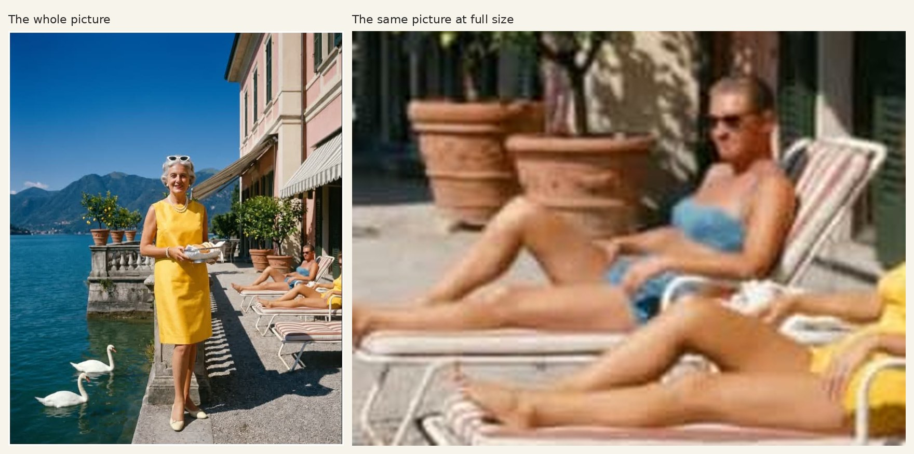

# Catch the mistakes in AI pictures that only show at full size

Crop the lettering, the hands and every face in the background to full size before anyone judges the picture. Fail it on a fixed list of faults, keep that list apart from the score, and judge the look beside a sheet of the pictures you already kept.

## What happened

Our first full-size check ran on 25 November over 20 new pictures, and 17 failed. Most of them looked right on a phone. The commonest fault was the small line of hotel and town printed under the main word on the back of a shirt: "THE ORIDLE PALACE", "LOS ANIELES". Garbled newspapers and magazines on the loungers came second.

On 26 November a remade portrait of the Contessa at Villa Ceresa looked like a keeper. At full size, one of the sunbathers behind her had a man's head on a woman's body in a blue bikini. A take of Kit at Hotel Marisol had a car maker's badge painted on the van's hubcaps. Both were retaken.

The same day we compared the blind scores with Alex's own on 32 pictures. The averages came within 0.2 of a point. The keep-or-drop calls agreed on 17 of 32. His five top scores came out lower because the small lines on the back were garbled at full size. He chose to count that fault once, in the checks, and to keep the score for the picture as a whole. We rescored 20 pictures on that rule and most still failed, nearly all on the hotel and town line.

## Pictures



Left: the whole picture. Right: the sunbather behind her at full size.

## What to do

1. Open every new picture at full size and crop four places: any lettering, the hands, the faces in the background, and the edges of the frame.
2. Check against a short fixed list and log the fault by name, so you can count them later. Ours: shirt colour, shirt print, hands, faces, stray text, cut-off heads or feet, modern objects, frame, any tool mark, wrong name, off the look.
3. A fault fails the picture whatever its score. Keep the faults out of the score itself, so one garbled line doesn't count twice.
4. Give the checker the exact words that should appear on a product, letter for letter, and a flat photo of the product to compare against.
5. Judge the look beside a single sheet of the pictures you already kept. A picture that would stand out in that sheet fails, even with a good score.
6. Compare the checker's picks with a person's picks on the same pictures before you trust either. An average can match while the picks differ.

## Prompt (generic)

```
Check this picture at full size before scoring it. Crop and read: every piece of lettering, both hands of every person, every face including the background, and all four edges. The product should read "[exact words]" in [colour] on [garment colour]; compare it with the flat product photo. List each fault from this list by name: shirt-colour, shirt-print, hands, faces, stray-text, cut-off, modern, frame, ai-mark, name, off-look. Then score the picture as a whole, ignoring any fault already listed. Open the sheet of kept pictures and say whether this one would stand out in it.
```

## Prompt we used (Off Duty Hotel Club)

```
Check this picture at full size before scoring it. Crop and read every piece of lettering, both hands of every person, every face including the guests on the loungers, and all four edges. The Lifeguard shirt's back should read "LIFEGUARD" with the Hôtel Solvane line under it, letter for letter as on the flat back shot attached; compare colour, ink and placement too. List each fault by code: shirt-colour, shirt-print, hands, faces, stray-text, cut-off, modern, frame, ai-mark, name, off-look. A garbled small line on the back fails shirt-print and leaves the Shirt score alone. Then score Real, Shirt and Look out of 5 each. Open the look book sheet and fail as off-look anything that would stand out in it: too real, or soft and muted.
```

## Settings

| Setting | Value |
| --- | --- |
| When | Every new picture, before anyone reviews it |
| Batch | Up to 20 pictures a pass, newest first |
| Keeper | 12 of 15 or more, with no faults |

## Cost

Free to run. A pass of 20 pictures took about 20 minutes. It saves a person's review time and stops a faulty picture reaching a post.

## Lessons

| Lesson | Status |
| --- | --- |
| `small-lines-fail-first`: The small hotel and town line on a shirt back garbles most often and reads fine at phone size. Crop it every time. | tested |
| `background-faces`: The faces behind the subject go wrong more often than the subject's. A man's head on a sunbather passed at a glance and showed at full size. | tested |
| `no-lettering-anywhere`: Ask for no lettering, logos or badges anywhere in the frame. A van came back with a car maker's badge on its hubcaps. | tested |
| `count-a-fault-once`: Fail the picture on a fault and keep the fault out of the score, so one garbled line doesn't sink a good picture twice. | tested |
| `same-average-different-picks`: Blind scores matched a person's average on 32 pictures and agreed on keep or drop for only 17. Compare picks. | tested |
| `judge-beside-the-keepers`: A written description let the look drift for two days. A sheet of the pictures you kept, opened beside each new one, holds it. | try |

## Next to try

Mend the small back line in an editor after generation and see if it beats a retake on cost per usable picture.

## History

- 2026-11-26: First written from the first two days of full-size checks.
