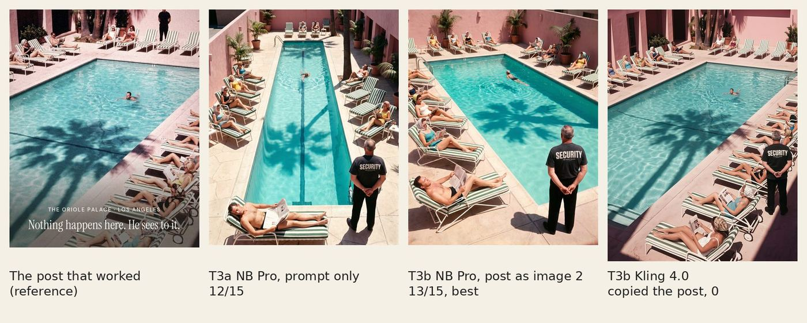

# Make your best picture the reference for the next ones

Write down the six things that make the picture work, then attach the picture itself as the style and layout reference. It brings back the camera and the light, but it does not lift the average take, and the model may copy its guests. Tested on Nano Banana Pro.

## What happened

On 25 November Alex opened an Adobe Express page from 20 November and called it "absolutely perfect": the pool at The Oriole Palace seen from a balcony, a palm shadow across the water, guests on striped loungers and one man in black standing at the back. The caption reads "Nothing happens here. He sees to it."

It is ours. The picture is `O01_oriole-palace_society.jpg` in the Creative Cloud library, uploaded on 20 November with the rest of the Oriole Palace pictures. It most likely came from the Oriole Palace set we made on Nano Banana Pro in early November, though no run log names it. The post is `oriole-1_O01.jpg`, laid out in the Express document "Untitled - 20 November 2026 at 19.36.16". The exact prompt was never saved beside the file, so we can describe the picture and rebuild the recipe, and we can't run the original again. That is the first lesson.

Our last framing test showed where a layout reference can go wrong. In test T1 a grey blocking sketch as a third image cut Real from 2 to 1 on both scored takes (11 of 15 down to 10), and rewriting the bans as positive wording took it to 9 and 8. The sketch's flat grey seems to leak into the picture. A real photograph carries the same layout with the right texture, so that is what we test next.

## Pictures



From left: the Oriole Palace post we wanted more of; T3a, the six points as words only (11 or 12 of 15, the pool turned into a lap lane); T3b, the same words with the post attached as image 2 (12 or 13 of 15, the corner-to-corner pool and palm shadow back); and Kling Image 4.0, which handed back the post itself and scored 0.

## Results

| Run | Without the picture (T3a) | With the picture (T3b) | Difference |
| --- | --- | --- | --- |
| Nano Banana Pro on Kling, 25 Nov | 11.75 of 15 | 12.7 of 15 | +0.9 |
| Nano Banana Pro in Google Flow, 27 Nov, picture cropped and a "don't copy its people" line added | 11.5 of 15, Real 4.0 | 10.5 of 15, Real 3.5 | -1.0 |
| Kling Image 4.0, 25 Nov | 9.3 of 15 | copied the picture 4 of 4 times, 0 | |

The picture did its first job. With it attached the camera went steeper, the courtyard turned back into plain pink stucco and the palm shadow sat across the water. It did not lift the average. In Flow it cost the shirt: two of four takes dropped the small lines under SECURITY and one printed the wrong hotel name. The best single take of the whole test (13 of 15) still came from the arm with the picture.

So the picture is not a default reference. Use it when you want this exact camera and courtyard and are happy to make more takes and pick the best; write the six points as words for everything else. Always crop the reference so no guest is large enough to copy, and add the line "do not copy its people".

## What makes it work

| Element | What the picture does |
| --- | --- |
| Camera | High, from a second-floor balcony, looking steeply down the length of the pool. The pool runs corner to corner, lower left to upper right, and fills about half the frame. The deck edge makes a second diagonal. |
| Light | Noon sun from behind the camera. One palm's shadow lies across the water in the lower left, the darkest shape in the frame. It gives depth and a time of day. |
| Story beat | One staff member in black stands at the far wall, upright, hands behind his back, apart from everyone. He is the only vertical figure and the only one at work. You see him second, and the caption sends you back to him. |
| Crowd | About fifteen guests on white loungers with green-and-white striped cushions along both long sides: magazines, headscarves, white sunglasses, one-piece swimsuits. One swimmer mid-pool gives scale. Nobody looks at the camera. |
| Colour | Pink stucco, turquoise water, sage stripes, warm skin, cream stone. A faint warm-magenta cast, highlights close to burning out, fine grain, soft edges. The post adds the house grade and a soft full-frame shade that darkens the bottom third for the type. |
| Type | Bottom centre over the shade. A small tracked-capitals label (hotel · place, no number) and one serif line under it, on one line, about eight words. The line pays off the story beat. |

The type spec at 1080 × 1350, as the social factory builds it from 25 November: label Neue Haas Unica 500, 24px, letter-spacing 0.12em, capitals, 26px above the line; line FreightBig Pro Book 400, 56px, line-height 1.1, letter-spacing −0.01em; both in the brand's on-dark colour, centred; shade a linear gradient from clear at 35% to 65% `#172016` at the bottom edge. Fonts load from Adobe Fonts kit `lxh4muu`. The original post set the same layout in Instrument Serif and DM Sans; Alex moved social to the brand pair on 25 November, and the line came down from 62px because FreightBig sets wider. See [live text in Express](live-text-in-adobe-express.md) for getting it in with the text still editable.

## What to do

1. Find the picture's source file and its prompt, and save the prompt in the same folder as the file under the same name.
2. Write down what makes it work under the six headings above. Each line should be something a model can be told.
3. Attach the picture itself as a reference and give it one job in the first lines of the prompt: camera height and angle, the main shapes, where people stand, colour and light.
4. Say what changes. New people in new poses, and anything you need moved (here, the staff member comes forward so the shirt reads).
5. Make four takes a side against your usual prompt and score all of them. Mark any take that rebuilds the reference person for person as a copy and score it 0.

Use only pictures you made or own. A photograph by a named photographer belongs to whoever holds their archive.

## Prompt (generic)

```
Two images are attached, each with one job. Image 1 is the [product]: copy its colour and print exactly. Image 2 is one of our own photographs: take its camera height and angle, [the main shapes], where the people are, and its colour, light and grain. Move [the person who must read] to [where], and make every other person a new person in a new pose.

[Your picture prompt, describing the same kind of place and moment.]
```

## Prompt we used (Off Duty Hotel Club)

Shot sheet rows T3a (control: the Security shirt and the Oriole hero for colour) and T3b (the same with this picture as image 2). The scene text is the same in both:

```
A 1960s colour photograph for a travel magazine, Los Angeles, August 1966, at noon. Seen from a second-floor balcony, looking steeply down the length of a long rectangular pool that runs corner to corner across the frame, the turquoise water taking up half the picture and the hard shadow of one tall palm lying across it. Pink stucco walls, potted palms and a cream stone deck. Guests lie on white-framed loungers with green-and-white striped cushions along both long sides: women in one-piece swimsuits, headscarves and white sunglasses reading magazines, a man asleep under a newspaper, one swimmer doing slow lengths. Nobody looks at the camera. Apart from all of them, at the near right corner of the deck, the hotel's security man stands perfectly still with his hands clasped behind his back, the only person standing, turned away from the camera so the back of his T-shirt reads in full. ...
```

The full text for both rows is in the shot sheet.

## Settings

| Setting | Value |
| --- | --- |
| Model | Nano Banana Pro |
| Ratio | 4:5 |
| Size | 2K |
| Takes | 4 per arm |
| Scored on | Real, Shirt and Period look, 1 to 5 each (see [scoring note](../notes/score-ai-pictures.md)) |

## References

- `oriole-pool-security-clean.jpg`: the picture without type, in the Drive "ODHC shot references" folder. The Drive copy is the 600px rendition the Express connector can read; the full-size file is `O01_oriole-palace_society.jpg` in Creative Cloud, and Alex can attach that one directly.
- `oriole-pool-security-post.jpg`: the finished post with its type, same folder, for the layout of the words.
- `shirt-security-back` and `hero-oriole`: the usual product and colour references.

## Cost

Free on Higgsfield Unlimited: eight takes for the test.

## Lessons

| Lesson | Status |
| --- | --- |
| `save-the-prompt-with-the-picture`: Our best Oriole picture lost its prompt because only the image was uploaded. Save the prompt beside every keeper under the same file name. | tested |
| `photo-as-layout-reference`: A picture that already works brings back its camera and light, but in T3 it lifted the average by 0.9 on Kling and lowered it by 1.0 in Flow, so it is not a default. | tested |
| `crop-the-reference-guests`: With a photograph as a reference, crop out any guest big enough to copy and say "do not copy its people"; Kling Image 4.0 handed the picture back four times out of four. | tested |
| `reference-costs-the-small-print`: A second picture competes with the shirt; in Flow two of four takes with the pool picture lost the small lines of the print. | try |
| `staff-apart-as-story-beat`: One uniformed staff member standing still among lounging guests gives the picture its story and puts the shirt in it. | try |
| `caption-pays-off-the-picture`: The one serif line works when it explains the odd figure in the picture, so write it after choosing the picture. | try |
| `social-uses-brand-type`: Social posts set type in the brand pair, FreightBig Pro and Neue Haas Unica, like the store (Alex, 25 November). | tested |
| `shadow-for-depth`: A single hard palm shadow across water gives a top-down picture its depth and its time of day. | try |

## Next to try

Try the picture as a reference on the Higgsfield website with Unlimited at 4:5, and put the shirt last in the prompt as well as first, to see whether the small print survives.

## History

- 2026-11-27: T3 results added from Kling (25 Nov) and Google Flow (27 Nov). The picture is not a default reference.
- 2026-11-25: Type spec moved to FreightBig Pro and Neue Haas Unica after Alex chose the brand pair for social.
- 2026-11-25: First written from the Oriole pool post Alex picked in Express. Test T3 set up in the shot sheet, not yet run.
