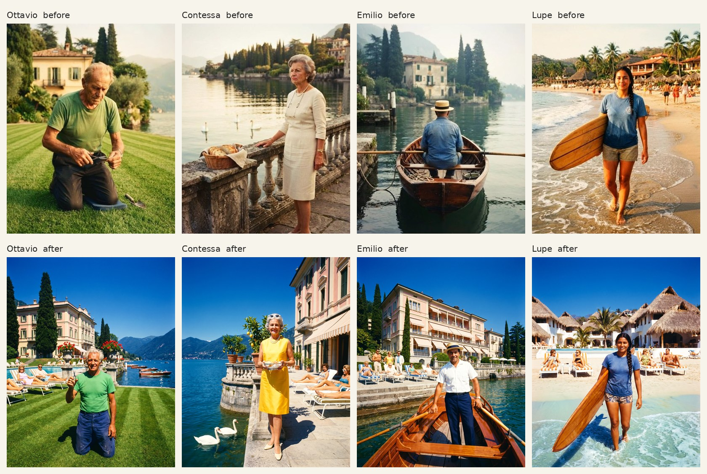

# Bring a set of AI pictures back to your look when they drift soft, misty or golden

Look for the light words in the scene. "Misty morning" and "golden hour" beat any style paragraph that comes before them. Name hard midday sun and a cloudless deep-blue sky in every prompt, give the subject one strong colour, and the look comes back in one pass.

## What happened

On 26 November we laid 23 of our early pictures side by side so Alex could pick the ones that define the house look. He kept 19. He put the three Villa Ceresa portraits (Ottavio the gardener, the Contessa, Emilio the boatman) outside it: "completely off". Next to the keepers they were soft and milky, with a white sky and faded cream clothes. The four Hotel Marisol portraits had the same fault in orange: a golden cast from edge to edge.

Every keeper shares three things: hard midday sun, a deep blue sky across the top of the frame, and one strong colour on the person. The rejects had none of them, and the reason was in our own words. The Ceresa scenes asked for a "still lake" in the "cool of the morning". The Marisol palette said "in warm low golden light", and its scenes added "late-afternoon gold" and "golden hour". The style paragraph at the top of each prompt asked for sun and saturated colour. The scene came later and was more specific, so the scene won.

## Pictures



Top row: Ottavio, the Contessa, Emilio and Lupe as first made. Bottom row: the same people after the fix, with the house grade on top.

## What to do

1. Lay the drifting set beside the pictures that define your look. A drift that seems fine on its own stands out at once in a row of keepers.
2. Read every prompt for light words: morning, mist, dusk, golden, late afternoon, low sun. Check any shared palette or brand text that gets pasted into prompts too. Ours had "golden light" baked into one hotel's palette.
3. Take them out and name the light you want, in the same words, in every prompt: midday sun from high behind the photographer, crisp hard shadows, a cloudless deep-blue sky across the top of the frame.
4. Give the subject one strong colour (a sunflower-yellow dress, a lawn-green shirt). Cream and white on their own read as muted.
5. For a portrait, say it is a portrait. If your style paragraph says nobody looks at the camera, add a sentence that makes this frame the exception, or the model splits the difference.
6. Ask for the shoes in frame and say "no lettering, signs, logos or magazines". The light fix brought the look back and left cut-off feet and stray writing behind.
7. Check every take at full size before anyone else sees it (see [Catch the mistakes that only show at full size](check-ai-pictures-at-full-size.md)).

## Prompt (generic)

```
[Your style paragraph.]

This frame is a portrait, the one exception to the rule above: one person, full length, centred, square to the camera and looking straight into the lens. Midday sun from high behind the photographer, crisp hard shadows, a cloudless deep [sky colour] sky filling the top of the frame, every colour rich and saturated. [Who they are], in [one strong colour], at [where], with [two or three props]. Shoes in frame, [ground] below the feet. Vertical 4:5, full-bleed. No lettering, signs, logos, badges, magazines or newspapers anywhere in the frame.
```

## Prompt we used (Off Duty Hotel Club)

```
[House style paragraph.]

This frame is an environmental portrait, the one exception to the rule above: one person, full-length or three-quarter length, centred, standing or sitting square to the camera and looking straight into the lens with easy confidence, posed like a 1960s society portrait. Midday sun from high behind the photographer, crisp hard shadows, a cloudless deep cobalt-blue sky filling the top of the frame, every colour rich and saturated like a postcard. Contessa Ada Bollini, an elegant silver-haired woman in her sixties in a sleeveless sunflower-yellow silk shift dress, pearls and white cat-eye sunglasses pushed up on her head, standing at a stone balustrade on the lakeside terrace holding a silver bread basket, two white swans on the bright blue water below her; pink-and-cream villa, terracotta pots of lemon trees, a striped awning and green mountains across the lake. Vertical 4:5, full-bleed. No text or lettering anywhere in the frame, no border.
```

Our house paragraph sets the place, the year, the film stock and the crowd. It comes first in every picture prompt and stays the same. The pick is the second retake, which added "shoes in frame, pale paving below her feet" and the full no-lettering line from the generic prompt.

## Settings

| Setting | Value |
| --- | --- |
| Model | Nano Banana Pro, run on Kling |
| Ratio | 4:5 |
| Size | 2K |
| Takes | 2 a person |
| References | None |
| After | House grade on the picks |

## Cost

About 40 credits a usable picture. Each take cost 20 credits. All 17 takes held the look. 9 of 17 passed every check, and the rest failed on cropped feet, lettering, a car badge on the hubcaps and a man's head on a sunbather in a bikini. Seven picks from 400 credits.

## Lessons

| Lesson | Status |
| --- | --- |
| `light-in-scene-wins`: Light words in the scene beat the style paragraph. Naming midday sun and a cloudless blue sky in every prompt held the look on 17 of 17 takes. | tested |
| `check-shared-palettes`: A palette line pasted into every prompt for one location ("warm low golden light") turned all of that location's pictures orange. Read the shared text as well as the scene. | tested |
| `portrait-exception`: When the style paragraph says nobody looks at the camera, a portrait needs a sentence saying it is the exception. | tested |
| `one-strong-colour`: Cream and white outfits on their own read as muted. One strong colour on the subject carries the look. | tested |
| `look-book-side-by-side`: Judge a set in a row with the keepers. A drift that looks fine alone stands out at once. | tested |
| `feet-and-no-lettering`: The look held, and 7 of 13 first takes still failed on cropping or writing. "Shoes in frame" and "no lettering, signs, logos or magazines" fixed 3 of 4 retakes. | tested |

## Next to try

Run the same portrait sentence on Recraft with the saved house style and compare cost per usable picture.

## History

- 2026-11-26: First written after remaking the Villa Ceresa and Hotel Marisol portraits.
